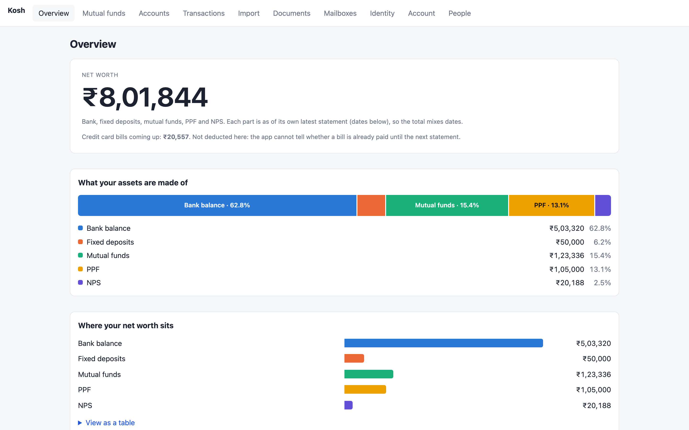
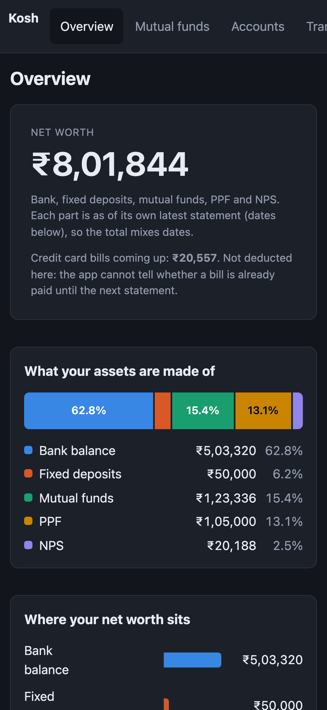
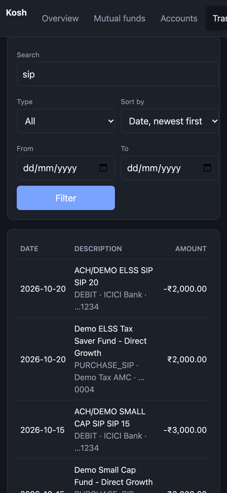
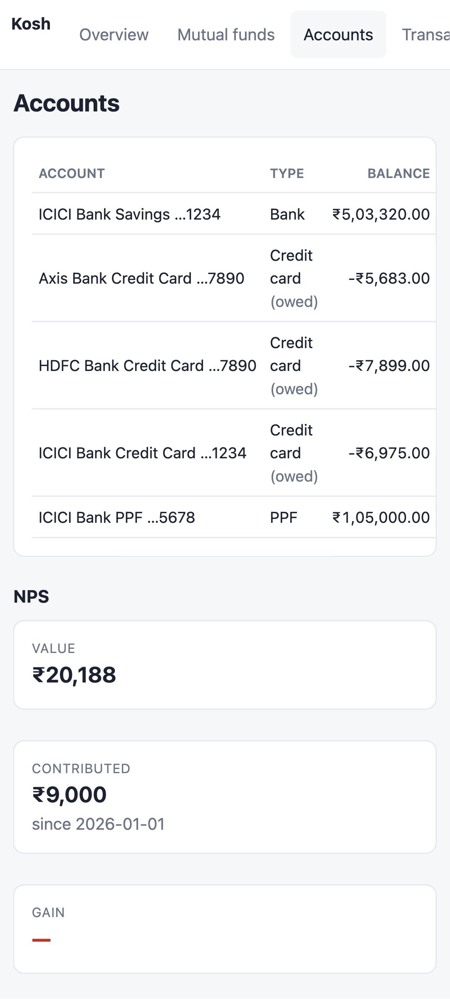
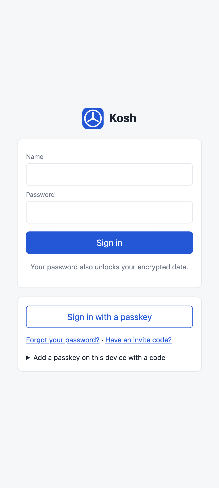

# Kosh

*kosh* (कोश) means treasury or vault: a self-hosted personal finance tracker for Indian assets. It reads the statements you already receive (bank, credit card, mutual fund CAS, NPS) and shows your net worth on your own machine.

## Why I built this project

Like most people in India, my money is spread across bank accounts, credit cards, mutual funds and a few savings and retirement schemes. Each sends its own statement, usually as a password-protected PDF, and none of them shows the whole picture. Answering "what am I worth today?" or "what are my card bills this month?" meant opening a pile of PDFs.

The apps that promise a single view want your bank logins or send your statements to someone else's servers. I did not want that for data this sensitive. Kosh does the opposite: it reads statements you give it (or that arrive in a mailbox it can only read), parses them with deterministic code, refuses anything whose arithmetic does not add up, and keeps everything in a SQLite file on your own machine. Nothing is sent anywhere.

What I wanted from it, beyond a net-worth number:

- **One place, one search box.** Bank, cards, mutual funds, PPF and NPS rows sit in a single Transactions page. Type `sip` and see every SIP across every fund, with each fund's date and amount side by side, instead of opening each AMC's statement to find out which SIP runs on the 5th and which on the 20th. Type a merchant, a fund name, an amount or a date and press Filter: several words narrow the list together (`sip 2026-10`, `5,000 hdfc`).
- **Filter and sort quickly.** Cut by account type (cards, bank, mutual funds, NPS), by transaction type and by date range, then sort by newest, oldest, largest or smallest amount, or description. "What were my biggest card spends this year?" is two clicks.
- **See how I spend.** Card spending by month and bank cash flow by month are on the Accounts page, so I can see whether spending is climbing and which months were heavy. Categories, recurring-payment detection (subscriptions, SIPs, EMIs) and "where can I cut" views are the next things on the [ROADMAP](ROADMAP.md).
- **Mine to customise.** Apps like CRED show what they decide to show, on their servers, and change when they like. Here the data is a SQLite file and the code is open: add a parser for your bank, a view for how you think about money, or a rule for how you categorise, without waiting for anyone.

## Where it stands

- **Reads your statements locally**: ICICI bank (with FD and PPF), ICICI / HDFC / Axis / Tata credit cards, CAS mutual funds, and NPS, with checks that refuse anything whose arithmetic does not add up.
- **Net worth, accounts, card dues and one searchable, sortable transaction list** across all of it.
- **Profiles for the whole family**, each encrypted for that person alone (AES-256-GCM under a key only their password and recovery key can open), so not even the admin can read another person's data. Sign-up is by invite, sign-in by passkey or password, all from the browser.
- **An installable phone app (PWA)** you can host on your own server or over Tailscale; it never stores your figures on the device.
- **Docker image, dummy sample statements for every layout, and a long [ROADMAP](ROADMAP.md)** of banks, cards and features that still need building.

<p>





</p>

*Screenshots use invented demo data.*

## Quick start

**Prerequisites:** Python 3.10+ (developed on 3.14).

```bash
git clone https://github.com/phaninderg/kosh.git
cd kosh
python -m venv venv && source venv/bin/activate
python -m pip install -r requirements.txt          # use `python -m pip`, not bare `pip`
cp .env.example .env                               # optional: everything in it has a default

python main.py ui                                  # prints a one-time setup code and opens the browser
```

Then everything happens in the browser: enter the setup code, choose your name and a password, and **save the recovery key** you
are shown. The first profile is the admin; family members join later with invite codes you create on the **People** page. Each
person's data is encrypted for them alone, so not even the admin can read it.

### With Docker (about two minutes)

```bash
docker run -d --name kosh -p 127.0.0.1:8765:8765 -v kosh-data:/app/data ghcr.io/phaninderg/kosh:latest
docker logs kosh          # prints the setup code; open http://localhost:8765/signup and create your profile
```

Or `docker compose up -d` from a clone (set `KOSH_PORT=9000` first if 8765 is taken, and change both sides of `-p` the same way plus `-e KOSH_PUBLIC_PORT=9000` if you use `docker run`). Everything lives in the `kosh-data` volume, so it survives upgrades (`docker pull`, then recreate the container). Things to know:

- Publish the port on `127.0.0.1` only, as above, unless you follow [docs/HOSTING.md](docs/HOSTING.md) (HTTPS, a real domain or Tailscale).
- Your data is encrypted with a key that only your password and recovery key can open. Back up the whole volume; the archive is encrypted too.
- After a restart, or 8 idle hours, you enter your password once to unlock your data again.
- To try it without your own statements, upload the dummy PDFs from `samples/` in this repo (Import page; passwords are listed in `samples/manifest.json`).
- Build it yourself with `docker build -t kosh .`

First run in the UI:
1. **Identity**: add your name, date of birth and other personal details (they build PDF passwords in memory and are kept sealed in your own vault).
2. **Import**: upload a *detailed* CAS PDF (CAMS / KFintech / MF Central), or set up **Mailboxes** and press **Sync now**.
3. **Overview** shows your net worth; **Mutual funds** has holdings, invested, value, XIRR. If the red "not reliable" banner appears, open **Review**.

**On your phone:** Kosh is an installable web app (PWA). Run it on a small server with HTTPS, create your profile, then Add to Home Screen and add a passkey (Face ID / fingerprint). Steps, with a Tailscale option that keeps it off the public internet, are in [docs/HOSTING.md](docs/HOSTING.md); what is and is not protected is in [SECURITY.md](SECURITY.md).

Restart `python main.py ui` after pulling code changes: templates reload by themselves, Python code does not.

## Testing and development

```bash
python -m pip install -r requirements-dev.txt
python -m pytest                      # no network, no real data, no real mailbox
```

- Tests use synthetic fixtures only; an autouse fixture gives every test a temporary data folder and its own signed-in profile with an encrypted vault, so nothing can touch a real `data/`.
- Mutation-style checks guard the important guarantees (read-only IMAP, allowlist, summary matching, history completeness).
- Never commit real statements or real personal data. Parser tests build synthetic PDFs in code (`tests/pdffix.py`, `tests/cardfix.py`, `tests/npsfix.py`), and `samples/` holds a dummy PDF for every supported layout.

## Contributing

Kosh reads only the formats listed under "What it can read today" above, and India has far more banks, cards and asset types than any one person can cover. **Start with [ROADMAP.md](ROADMAP.md)**: it lists what works today, what is still pending (more credit card issuers, nationalised banks, EPF, loans, EMIs, richer transaction types and much more), the design decisions, and the lessons real statements taught us.

To add a new statement layout: build a **synthetic** sample (never a real statement), write the parser as a small plugin, add the integrity checks the arithmetic allows, and keep `python -m pytest` green. The steps are in the ROADMAP and in [samples/README.md](samples/README.md).

## Built on

| Library | Used for |
|---|---|
| [casparser](https://github.com/codereverser/casparser) | CAS PDF parsing (local) |
| [pdfplumber](https://github.com/jsvine/pdfplumber) | Bank, card and NPS statement PDF parsing (local) |
| [FastAPI](https://fastapi.tiangolo.com/) · [htmx](https://htmx.org/) · [Chart.js](https://www.chartjs.org/) | The local web UI |

## Disclaimer

This is a personal record-keeping tool, not investment advice. The parsers are written against specific statement layouts and may not match every variant; always check the numbers against the statement itself. Mutual fund investments are subject to market risks.

## License

[MIT](LICENSE)
